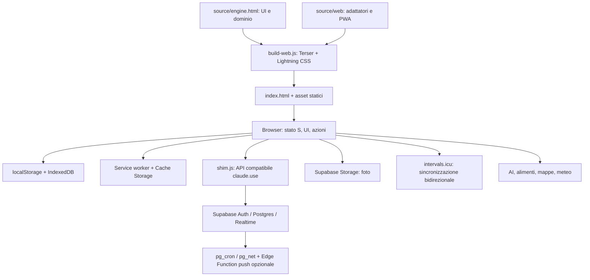

# Architettura di Engine

Analisi del 23 ottobre 2026, baseline `cae350d409daa68d01f0031298d9de9eff3464c7`,
aggiornata per M1 Storage/Shopping.
Descrive il codice disponibile; non certifica la configurazione dei servizi in produzione.

## Aggiornamento M1 — inventario

`source/web/inventory.js` fornisce funzioni pure per fabbisogno, scorte, consumi,
acquisti e annullamenti. Il build lo incorpora prima dello shim e dell'applicazione.
La UI usa una transazione locale su `shop` e `days`: backup iniziale verificato,
snapshot durevole unico, poi accodamento cloud. `shop.inventoryV = 1` identifica
l'adozione del formato additivo alla prima scrittura; `stockUsed` registra il prelievo
effettivo dei nuovi consumi. I flag legacy `pan` sono conservati ma ignorati nel
calcolo della copertura. Nessuno schema/server nuovo.

Il backup `engine.inventory.backup.v1.<uid|local>` contiene solo `shop` e `days`.
Le scritture cloud restano documenti separati: questa atomicità è locale e non
risolve conflitti tra dispositivi o isolamento account. Contratti, compatibilità e
rollback sono descritti in [M1_STORAGE_SHOPPING.md](M1_STORAGE_SHOPPING.md).

## Struttura e flusso

Engine è una PWA statica per allenamento e nutrizione. HTML, CSS e JavaScript vanilla
gestiscono interfaccia, dominio e persistenza nel browser. Non c'è un server applicativo
necessario per la modalità locale. Il README indica GitHub Pages come hosting.

| Area | Responsabilità |
| --- | --- |
| `source/engine.html` | Circa 12.600 righe: CSS, modelli, calcoli nutrizionali/sportivi, schermate, timer, GPS, backup, import/export e azioni |
| `source/web/shim.js` | Adattatore `window.claude.use()`, autenticazione, documenti Supabase, coda offline, download e provider AI |
| `source/web/icu-direct.js` | Lettura/scrittura diretta di allenamenti, piano, benessere e gare su intervals.icu |
| `source/web/after.js` | Estensioni web: account, impostazioni AI, sync e registrazione service worker |
| `source/build-web.js` | Assemblaggio con sostituzioni testuali, minificazione JS/CSS, copia asset |
| `source/web/sw.js` | Template del service worker; cache delle risorse, avvio offline, push |
| `source/web/config.js`, `config.js` | URL e chiave pubblica Supabase, chiave VAPID pubblica opzionale |
| `vendor/`, `ocr/` | Supabase JS, Tesseract, ZXing, worker/core WASM e modello italiano vendorizzati |
| `supabase/` | SQL dichiarativo, istruzioni push e funzione Deno |

Il build inserisce lo shim prima dello script applicativo e gli adattatori ICU/web dopo.
Gli oggetti globali `S`, `UI`, `Sync`, le mappe `ACT`/`CHG` e i registri di schermate
accoppiano i moduli. La compatibilità con `claude.use()` è ancora parte del runtime:
non implica dipendenza attuale dal servizio Claude per la modalità locale.

## Stato e persistenza

| Supporto | Contenuto e contratto attuale |
| --- | --- |
| `localStorage: fuelplanner.v1` | Snapshot di impostazioni, alimenti, ricette, giorni, diario mensile, acquisti, corpo, allenamento |
| `engine-auth` | Sessione Supabase nel browser |
| `engine.q` | Coda globale di scritture offline; gli elementi non contengono un proprietario account |
| `engine.snap.<uid>` | Snapshot cloud associato all'utente |
| Altre chiavi `engine.*` | Preferenze UI, timer, promemoria, meteo e stato ausiliario |
| IndexedDB `engine-photos` | Blob delle foto, object store `p` |
| IndexedDB `engine-backup` | Punti di ripristino e handle della cartella backup, store `pts` e `kv` |
| Cache Storage | Risorse applicative e asset pesanti; distinto dai dati utente |
| Postgres `engine_docs` | PK `(user_id, path)`, documento JSONB e `updated_at` |
| Storage `progress` | Bucket privato, percorsi per utente e policy SQL di accesso |

Le scritture locali aggiornano lo stato e lo snapshot. In modalità autenticata lo shim
mantiene una cache di documenti, una coda persistente e un canale Realtime; usa upsert
di documenti interi. Non si vede un protocollo di confronto versione/compare-and-swap
per risolvere modifiche contemporanee allo stesso documento.

`schema.sql` abilita RLS e definisce policy per il proprietario; la loro presenza nel file
non dimostra che siano installate sul progetto remoto. Le chiavi AI/ICU fanno parte
delle impostazioni applicative: possono essere persistite e sincronizzate con esse.

I backup esportati dichiarano `app: Engine`, `version: 3`. Per impostazione predefinita
escludono chiavi e contenuto foto; i punti IndexedDB includono le chiavi e mantengono
gli ultimi 14 punti. Un punto locale non sostituisce un backup esterno del dispositivo.
La copia Git protegge il codice, non localStorage, IndexedDB, Postgres o file Storage.

## Servizi e confini di fiducia

| Servizio | Uso | Requisito |
| --- | --- | --- |
| Supabase | Account, documenti, Realtime e foto | Opzionale per locale; account e schema per cloud |
| intervals.icu | Sincronizzazione bidirezionale, anche modifiche/cancellazioni remote | Chiave personale; non attivare per smoke test |
| Gemini, Anthropic, OpenAI, Groq, OpenRouter, Mistral, Hugging Face, Cerebras, endpoint personalizzati | Analisi alimenti/foto e altre richieste AI, fallback tra modelli/provider | Configurazione e normalmente chiave dell'utente |
| Open Food Facts | Ricerca alimenti e barcode | Rete; immagini da relativo host immagini |
| Open-Meteo | Previsioni e geocodifica | Rete |
| MapTiler, OpenStreetMap, Esri, CARTO | Mappe e fallback | Rete; MapTiler richiede chiave |
| Google Fonts | Font | Rete; UI locale verificata anche con richieste esterne bloccate |
| cdnjs | Libreria XLSX caricata su richiesta | Rete per quel flusso |
| Web Push | Promemoria ad app chiusa | Setup Supabase, VAPID, cron e service-role lato funzione |

La funzione push usa `web-push@3.6.7` e `@supabase/supabase-js@2.45.4` via import npm
di Deno. Richiede `SUPABASE_URL`, `SUPABASE_SERVICE_ROLE_KEY`, `VAPID_PUBLIC`,
`VAPID_PRIVATE`, `VAPID_SUBJECT`, `CRON_SECRET`. Il segreto cron è controllato dalla
funzione; non inserirlo nei sorgenti o nel frontend.

La CSP limita alcune origini ma ammette script inline e connessioni HTTPS/WSS generiche.
I segreti in storage browser restano accessibili al JavaScript della stessa origine.
RLS non impedisce allo stesso client di attribuire per errore dati all'account corrente.

## Build e distribuzione

Non esistono manifest npm, lockfile, pin del runtime o CI nella baseline della repository.
Il build richiede Terser e Lightning CSS, risolti tramite `NODE_MODULES` o lookup Node.
La configurazione dell'ambiente cloud ha installato versioni esatte fuori dal checkout;
si veda `DEVELOPMENT.md`. Questo non equivale a una toolchain versionata nel progetto.

Senza argomento di output il build scrive nella radice. Con directory esterna copia
anche asset e `supabase/`. `config.js` viene copiato solo se assente nell'output:
una directory riutilizzata può mantenere configurazione precedente.

L'identificativo cache/build deriva dall'orario UTC al minuto. L'output non è quindi
identico byte per byte tra build a orari diversi. La strategia del service worker è
network-first per l'app e cache-first per asset pesanti; aggiornamenti e compatibilità
dei dati devono considerare client con versioni diverse. Su HTTP lo script registra
il service worker solo con hostname `localhost`, non `127.0.0.1`.
